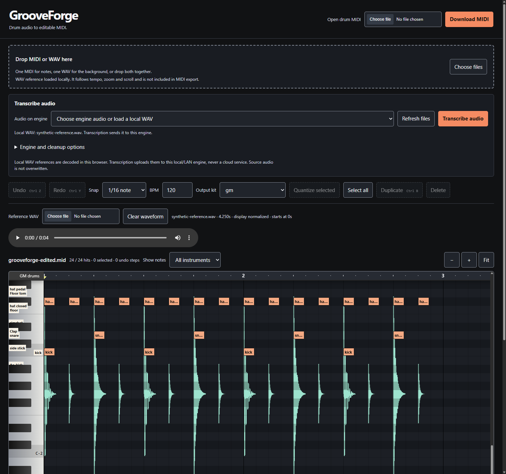

# GrooveForge

Ubah rekaman drum menjadi MIDI, rapikan placement note, lalu ekspor ke FL Studio. Web editor, desktop tkinter, dan library Python tersedia.

[English](README.md)

## Web editor



*Screenshot aplikasi nyata memakai MIDI dan WAV sintetis, bukan audio berlisensi.*

- Drop MIDI, WAV, atau satu MIDI dan satu WAV sekaligus.
- Snap berbasis beat, seleksi kelompok, quantize, velocity, duplicate, delete, undo/redo.
- Playback WAV, Space untuk play/pause, klik ruler untuk seek, playhead mengikuti audio sesuai BPM.
- Transkripsi di engine lokal/LAN; unduh seluruh take sesuai output kit, walau tampilan sedang difilter.
- Belum ada auto-follow scrolling atau sintesis suara MIDI. State editor hilang saat reload: ekspor dulu.

## Jalankan

Dari root repo, gunakan environment `.venv` yang sudah disiapkan:

```powershell
.venv\Scripts\python.exe -m pip install -r requirements-web.txt
.venv\Scripts\python.exe -m drum_midi.webui --host 127.0.0.1 --port 8123 --dir C:/path/to/audio
```

Buka URL bertoken yang dicetak server. Untuk LAN tepercaya gunakan `--host 0.0.0.0`; server bawaan tidak menyediakan TLS. WAV lokal baru di-upload ke engine saat meminta transkripsi, bukan ke layanan cloud.

Desktop Sun Valley (editor lebih sederhana, bukan GridSound):

```powershell
.venv\Scripts\python.exe -m pip install -r requirements-gui.txt
.venv\Scripts\python.exe drum_midi.py
```

## Dokumentasi

- [Web UI, shortcut, batas file dan API](docs/WEBUI.md)
- [Arsitektur dan mapping kit](docs/ARCHITECTURE.md)
- [Backend dan dependensi](docs/BACKENDS.md)
- [Workflow Hermes ke FL Studio](docs/HERMES.md)
- [Roadmap groove cleanup](docs/groove-roadmap.md)

Dokumen teknis memakai bahasa Inggris. Editor memakai pitch GM secara internal; mapping output kit diterapkan sekali saat ekspor. Input MIDI harus note-only dengan tempo konstan dan meter 4/4. Jangan mengandalkan label oktav antaraplikasi; gunakan nomor MIDI.

## Tes

```powershell
.venv\Scripts\python.exe -m pytest --basetemp=.pytest_tmp -p no:cacheprovider
node --test tests/*.test.mjs
```

Node hanya untuk tes frontend, tidak diperlukan untuk menjalankan aplikasi.

## Lisensi dan data

Kode aplikasi AGPL-3.0; komponen pihak ketiga mempertahankan lisensi masing-masing. Lihat [notices](THIRD_PARTY_NOTICES.md). Web UI menawarkan source melalui **Download source**. Data/audio/MIDI dari groove pack berlisensi tidak disertakan; generator memakai statistik yang kamu turunkan sendiri dari MIDI yang berhak kamu gunakan.
