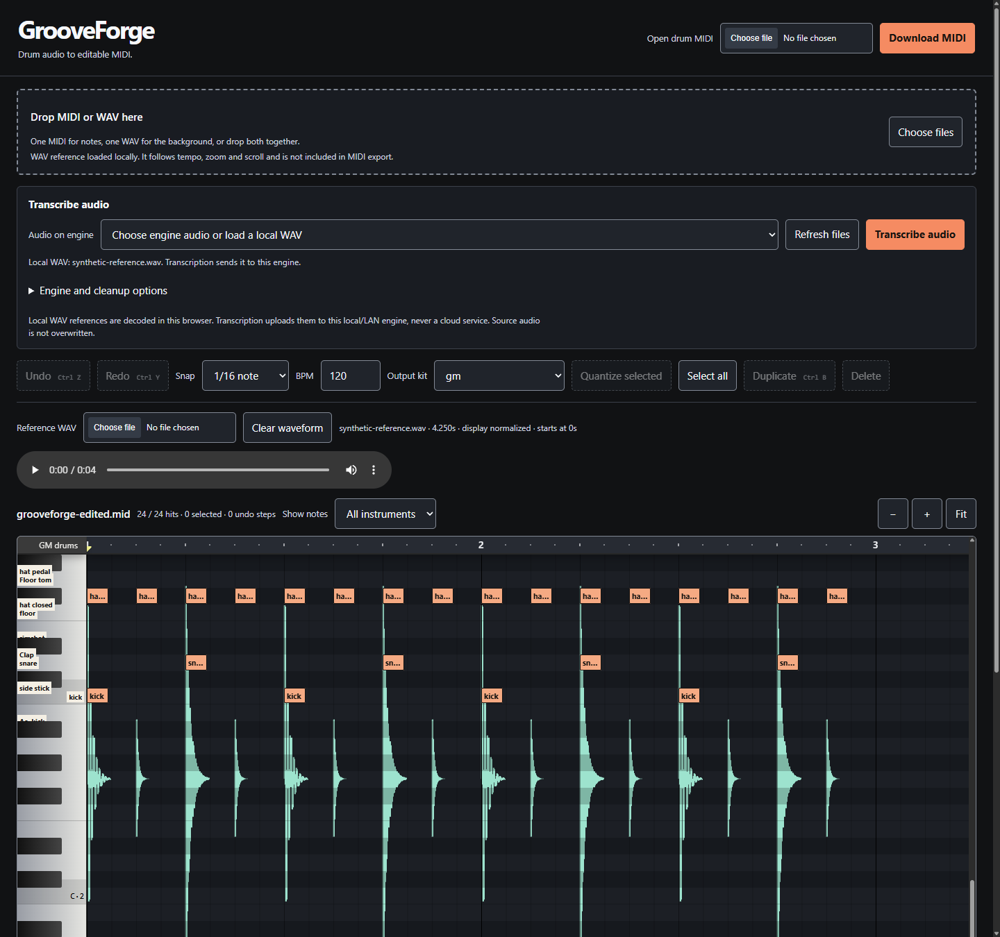

# GrooveForge

**Convert drum audio (full mix or stem) into MIDI you can edit in the FL Studio piano roll.**

The reason this exists: **stop drawing piano rolls by hand.** Record real drums → transcribe (GPU) → humanize → apply straight into FL Studio.

Desktop app + remote web UI + Python library (`drum_midi`).

[Bahasa Indonesia](README.id.md)

## Web editor



*Actual application capture using a synthetic two-bar MIDI take and reference WAV; no licensed audio is shown.*

- Drop MIDI, WAV, or one of each together.
- Edit with beat snap, group selection, quantize, velocity, undo/redo and kit-aware MIDI download.
- Play/pause WAV with Space, seek from the ruler, and follow its position with the synchronized playhead.
- Transcribe locally with the selected backend. No frontend build or cloud service required.

The web editor is not the same as the simpler Sun Valley tkinter interface. Auto-follow scrolling and MIDI sound synthesis are not included.

## Why

Drum transcription tools output note lists; you still spend hours dragging notes onto a piano roll. GrooveForge closes that gap: a real drum take becomes a playable MIDI pattern in FL, at the song's tempo, with humanized timing/velocity — no manual drawing.

## Quickstart

Run from the repository root with the existing `.venv`. Set `PATH` below to your audio folder. See [dependencies](docs/BACKENDS.md) for creating an environment; neural backends require separate setup.

```powershell
# desktop GUI (Sun Valley dark theme)
.venv\Scripts\python.exe -m pip install -r requirements-gui.txt
.venv\Scripts\python.exe drum_midi.py

# web editor / transcription engine
.venv\Scripts\python.exe -m pip install -r requirements-web.txt
.venv\Scripts\python.exe -m drum_midi.webui --host 127.0.0.1 --port 8123 --dir PATH
# open the token URL printed by the server; use --host 0.0.0.0 for trusted LAN access
```

Headless generation:

```powershell
.venv\Scripts\python.exe -m drum_midi.groovegen --source C:/path/to/your_stats.json --bars 2 --seed 7
```

## Docs

- **[Architecture](docs/ARCHITECTURE.md)** — pipeline, source layout, groove cleanup, kit mappings.
- **[Backends & dependencies](docs/BACKENDS.md)** — trigger/bands/dettato/strum/adtof/madmom + install matrix + "use your own MIDI library".
- **[Hermes workflow → FL](docs/HERMES.md)** — drums → transcribe → humanize → apply into FL Studio.
- **[Web UI](docs/WEBUI.md)** — remote control, editor, endpoints.

## Tests

```powershell
.venv\Scripts\python.exe -m pytest --basetemp=.pytest_tmp -p no:cacheprovider
```
(BOTH flags required: `--basetemp=.pytest_tmp` because default points at hermes scratch → teardown fails on Windows; `-p no:cacheprovider` because TMPDIR hermes scratch.)

Synthetic fixtures: `python -m tests.make_fixtures`.

Optional frontend renderer tests (Node test runner only, no npm install or build):
`node --test tests/*.test.mjs`. Node is not required to run the app.

## License & data

GrooveForge application code is licensed under GNU AGPL version 3 (see `LICENSE`). Third-party components retain their original terms; see `THIRD_PARTY_NOTICES.md`. The web editor provides the current application source through its **Download source** link.

No licensed groove-pack data ships in this repo. Statistics/mappings derived from commercially-licensed packs (e.g. Sleep Token II by MixWave, GetGood Drums) are kept local-only. The groove generator works from **statistics you derive yourself** — analyze MIDI you own, then pass the JSON path (see [Use your own MIDI library](docs/BACKENDS.md)).
